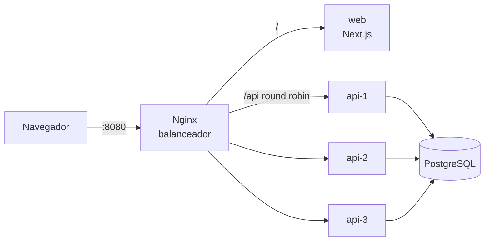
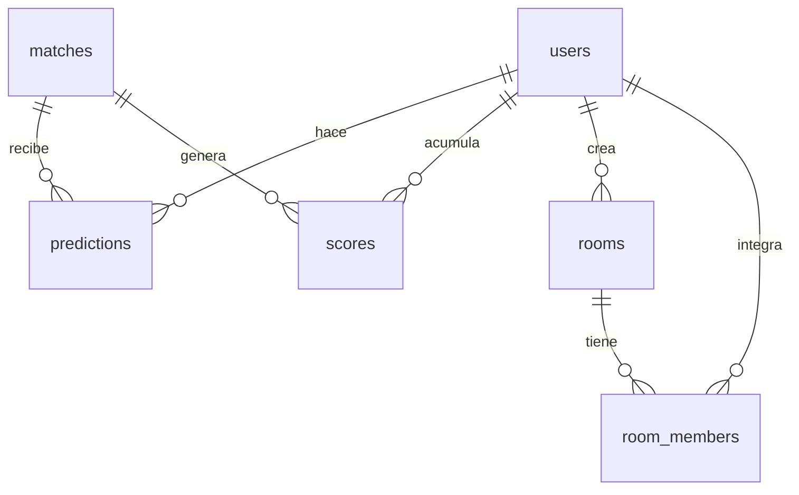

# Arquitectura

## Diagrama

Todo corre en una red interna de Docker. El único puerto publicado es el de Nginx.

| Pieza local | Equivalente en AWS |
|---|---|
| Nginx | Application Load Balancer |
| Réplicas `api` | Auto Scaling Group o servicio ECS |
| PostgreSQL | Amazon RDS |
| Docker Compose | Amazon ECS |

## Decisiones

- **API sin estado:** la sesión viaja en un JWT, así que cualquier réplica atiende cualquier petición.
- **Descubrimiento de réplicas:** Nginx usa el DNS de Docker con `resolve`, y detecta altas y bajas sin reiniciarse.
- **Cierre de predicciones:** se valida en la misma consulta SQL, con el reloj de la base de datos. Así las réplicas no dependen de su propio reloj.
- **Puntajes:** se guardan en `scores` y se regeneran en una transacción al cargar un resultado. Un bloqueo evita que dos réplicas recalculen a la vez, y corregir un resultado deja todo consistente.
- **Predicciones y salas:** cada usuario hace una predicción por partido, y esta cuenta en todas sus salas.
- **Límites:** cada réplica tiene 0.5 CPU y 256 MB, para que el efecto de escalar sea medible en una sola máquina.

## Modelo de datos

## Reglas de puntuación

La guía no aclara si las reglas se acumulan. Si solo contara la regla mayor, los 2 puntos de diferencia nunca se aplicarían, porque acertar la diferencia implica acertar el ganador. Por eso se suman. Con `SCORING_CUMULATIVE=false` solo cuenta la regla mayor.

| Caso | Puntos base |
|---|---|
| Marcador exacto con ganador | 5 + 3 + 2 = 10 |
| Empate exacto | 5 + 3 = 8 |
| Ganador y diferencia | 3 + 2 = 5 |
| Solo ganador o empate acertado | 3 |
| Sin acierto | 0 |

Criterios adicionales:

- **Empates:** no suman diferencia, porque no hay margen de victoria.
- **Racha:** +2 en cada tercer acierto seguido de ganador. Un fallo o un partido sin predicción la corta. Los partidos se ordenan por hora de inicio y luego por id.
- **Predicción anticipada:** +1 con más de 24 horas de anticipación, contadas desde la última edición, solo si ganó puntos base.
- **Último minuto:** se puede predecir hasta el inicio, y solo se reciben los puntos base.
- **Desempate del ranking:** puntos y luego marcadores exactos.

## Partidos

La base se carga con los 9 partidos del 4 de noviembre de 2026, tomados del [calendario oficial de UEFA](https://www.uefa.com/uefachampionsleague/news/02a8-2174c9e9019d-f909a77bd77a-1000--2026-27-champions-league-all-the-league-phase-fixtures/). Los resultados se ingresan a mano desde el panel de admin.
